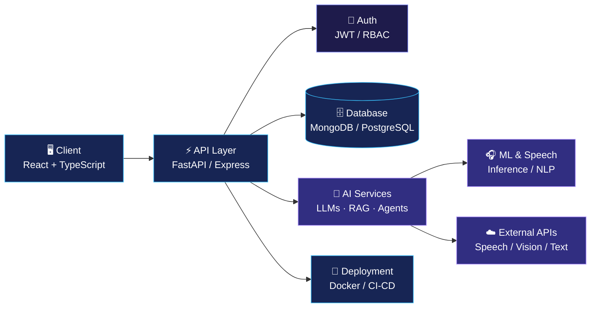

<table>
<tr>
<td width="28%" valign="top">

<div align="center">


### Shweta Rawat

**AI/ML Engineer**

📍 Pune, India

</div>

---

🎓 **B.Tech — AI & ML**  
PES Modern College of Engineering

📊 **CGPA** 9.6+

📅 **3rd Year** · 2024 – 2028

---

*"Building AI-powered solutions for a smarter tomorrow."*

---

### `~/navigation`

- [About](#01--about-me)
- [Projects](#02--featured-projects)
- [Tech Stack](#03--tech-stack)
- [Architecture](#04--system-architecture)
- [Experience](#05--experience)
- [Analytics](#06--analytics)
- [Current Focus](#07--current-focus)
- [Contact](#08--lets-connect)

</td>
<td width="72%" valign="top">


<div align="center">


<br/>

<a href="https://linkedin.com/in/shweta-rawat-01a71733a"></a>
<a href="mailto:shwetarawat6106@gmail.com"></a>
<a href="https://github.com/Shwetarawat061"></a>
<a href="https://leetcode.com/u/ShwetaRawat6106/"></a>


</div>

## `01` · About Me

I'm **Shweta**, a third year AI & ML engineering student at **PES Modern College of Engineering, Pune**. I'm passionate about building intelligent systems, working with **LLMs, RAG and backend technologies**, and creating real-world solutions that make an impact.

My interests sit at the intersection of **Generative AI, LLM applications, backend engineering, and applied machine learning.**

```python
class ShwetaRawat:
    role = "AI/ML Engineer"
    focus = [
        "Generative AI",
        "LLMs & RAG",
        "AI Agents",
        "Backend Engineering",
        "System Design"
    ]

    mindset = "Build. Learn. Improve. Repeat."
```

</td>
</tr>
</table>

---

## `02` · Featured Projects

<table>
<tr>
<td width="50%" valign="top">

### 🛡️ VeriVox

**Voice anti-spoofing & speaker verification**

Real-time detection of synthetic or cloned voices for safer communication.

   

- Speaker verification
- Voice anti-spoofing
- Risk scoring and real-time inference

[Explore repository →](https://github.com/Shwetarawat061?tab=repositories)

</td>
<td width="50%" valign="top">

### 🎙️ MeetSync AI

**Meeting intelligence microservices**

Transcription, summarization and actionable insights from meeting audio.

   

- Speech-to-text processing
- Decision extraction
- Modular AI service architecture

[Explore repository →](https://github.com/Durva-3124/meetsync-ai)

</td>
</tr>
<tr>
<td width="50%" valign="top">

### 🥗 NutriSync AI

**Personalized nutrition intelligence**

AI-powered meal analysis, personalized goals and nutrition insights.

    

- AI-assisted food analysis
- Nutrition goals and meal tracking
- Backend APIs and persistent storage

[Explore repository →](https://github.com/Shwetarawat061?tab=repositories)

</td>
<td width="50%" valign="top">

### 🔎 FactCheckAI

**AI-assisted claim evaluation**

Evaluates claims and presents structured credibility assessments using language models.

   

- Claim processing
- LLM-assisted analysis
- Structured verification results

[Explore repository →](https://github.com/Shwetarawat061?tab=repositories)

</td>
</tr>
</table>

<div align="center">

<a href="https://github.com/Shwetarawat061?tab=repositories"></a>

</div>

---

## `03` · Tech Stack

<table>
<tr>
<td width="33%" valign="top">

**Languages**


</td>
<td width="33%" valign="top">

**AI / ML**


     

</td>
<td width="33%" valign="top">

**Frontend & Backend**


</td>
</tr>
<tr>
<td width="33%" valign="top">

**Databases**


</td>
<td width="33%" valign="top">

**Tools & Infrastructure**


</td>
<td width="33%" valign="top">

**Core Concepts**

     

</td>
</tr>
</table>

---

## `04` · System Architecture

A simplified view of how I approach end-to-end AI application development.



---

## `05` · Experience

| Organization | Role / Program |
|:--|:--|
| **S3K Technologies / MyAIguru** | AI Analyst Intern |
| **Morgan Stanley** | Trainee |
| **Goldman Sachs** | Catalyst 2026 |
| **Katalyst India** | Scholar |

**Highlights**

- 🎓 CGPA **9.6+** in AI & ML engineering
- 🚀 Code Bharat Hackathon — advanced to Round 3
- 🏆 InnoThon 2025 — Finalist
- 💼 Goldman Sachs Catalyst 2026
- 🌱 Katalyst India Scholar

---

## `06` · Analytics

<div align="center">


<br/><br/>


<br/><br/>


<br/><br/>

<a href="https://leetcode.com/u/ShwetaRawat6106/">

</a>

<br/>


</div>

---

## `07` · Current Focus

<table>
<tr>
<td width="60%" valign="top">

```bash
$ cat current_focus.txt

> Building production-ready AI applications
> Exploring LLMs, RAG and agentic workflows
> Designing modular backend services
> Strengthening DSA and system design
> Learning deployment, testing and CI/CD

STATUS: ALWAYS BUILDING
```

</td>
<td width="40%" valign="top">

✅ Build scalable AI systems

✅ Contribute to open source

✅ Solve real-world problems

</td>
</tr>
</table>

---

## `08` · Let's Connect

<div align="center">

**Interested in AI engineering, open-source collaboration, or building something meaningful?**

<a href="https://linkedin.com/in/shweta-rawat-01a71733a"></a>
<a href="https://github.com/Shwetarawat061?tab=repositories"></a>
<a href="https://leetcode.com/u/ShwetaRawat6106/"></a>
<a href="mailto:shwetarawat6106@gmail.com"></a>

<br/><br/>

*"Great engineering isn't just writing code. It's making things work, reliably, for real people."*

<br/>

`Thanks for visiting!  ✦  Keep building  ✦`


</div>
